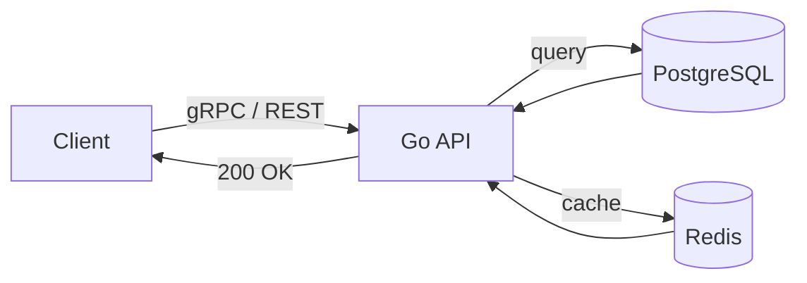

<div align="center">

# Michael Olajide David

### Backend-focused full-stack engineer. Go • gRPC • C#/.NET • Payments.

I build production web systems end to end, from database schema and API design to security and UI.

[**Live site**](https://michael-olajide-portfolio.vercel.app) · [**GitHub**](https://github.com/Olajide274) · [**LinkedIn**](https://www.linkedin.com/in/michael-olajide-david-b27859383) · [**Email**](mailto:michaelolajidedavid@gmail.com)


</div>

---

## Why this repo exists

Most portfolios are a wall of screenshots. Mine is built to show how I think about systems, because that's the job.

The hero is an animated request flow. The Trade Escrow card runs a live escrow state machine and a hash-chain you can "tamper" with. Every animation is there to explain something about backend engineering, not to decorate.

```
$ go test ./... -race
ok   escrow
ok   ledger
ok   audit
```

---

## How a request moves through the hero animation



---

## What's in the portfolio

| Section | What you'll find |
| --- | --- |
| **Featured systems** | Trade Escrow Protocol, WayTrust, CheckAm, Nexus Recon Engine, 1860 Travels ERP case study |
| **Live projects** | KadunaHomes, Xtreme Hotel demo, Chris Mitchell Jazz, BTC Essential |
| **Skills** | Grouped by what they're for (backend, data, payments, security, DevOps, frontend) |
| **Experience** | 1860 Travels Limited, Swift Digital Services |
| **Case studies** | One page per project at `/projects/[slug]`, with problem, architecture, what I built and the stack |
| **CV** | One-click download, always the latest version |

### The featured system I'm proudest of

**[Trade Escrow Protocol](https://github.com/Olajide274/trade-escrow-protocol)** is a Go/gRPC payment escrow backend:

- Paystack deposits with signature-verified webhooks
- A dispute and refund workflow
- A hash-chained audit log that makes tampering with transaction records detectable
- Concurrency tests that catch race conditions when transactions hit at the same time
- Origin-allowlisted CORS, security headers and request-size limits

---

## The rules I held myself to

Fancy animation is easy. Fast animation takes discipline. So:

- Only `transform` and `opacity` are animated, so nothing triggers layout
- No WebGL, Three.js, video or Lottie
- Every loop pauses when it's off-screen
- Below-the-fold animation code loads on demand
- `prefers-reduced-motion` users get a clean, static page
- No invented stats, no fake testimonials, no placeholder text anywhere

---

## Tech stack

- **Framework:** Next.js (App Router)
- **Language:** TypeScript
- **Styling:** Tailwind CSS with shadcn/ui components
- **Hosting:** Vercel, with automatic deploys from `main`

---

## Project structure

```
app/          Routes and pages (home, /projects/[slug])
components/   UI and animation components
data/         All site content lives here (edit this to update the site)
lib/          Helpers
public/       CV, screenshots, favicon
```

All copy, projects, links and skills live in `data/`. To add a project, add one entry. Buttons for GitHub, live site and case study appear automatically based on which fields are filled in.

---

## Run it locally

```bash
git clone https://github.com/Olajide274/michael-olajide-portfolio.git
cd michael-olajide-portfolio
pnpm install   # or npm install
pnpm dev       # or npm run dev
```

Then open [http://localhost:3000](http://localhost:3000).

---

## Updating the CV

Replace the PDF in `public/` and keep the filename the same. The download buttons pick it up automatically.

---

## Let's work together

I'm open to backend and full-stack roles, especially around payments, financial infrastructure and distributed systems.

- Email: [michaelolajidedavid@gmail.com](mailto:michaelolajidedavid@gmail.com)
- LinkedIn: [michael-olajide-david](https://www.linkedin.com/in/michael-olajide-david-b27859383)
- Agency: [Swift Digital Services](https://swift-digital-services.vercel.app)

<div align="center">

Built in Kaduna, Nigeria. 🇳🇬

</div>
